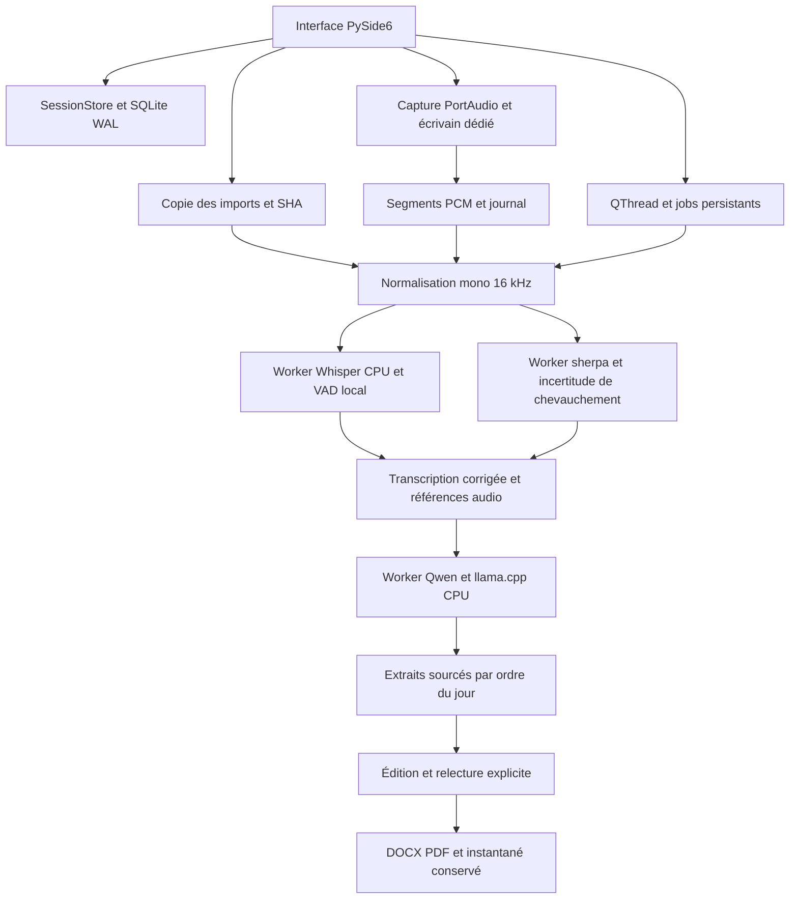

# Architecture de NoteTaker 0.1

Le socle Python 3.11, SQLite et workers indépendants est conservé. PySide6
Widgets fournit cinq onglets : séance, audio, transcription/voix, projet de PV,
décisions/votes. L’historique reste local. L’application de travail utilise le CPU.



## Modules

| Module | Responsabilité |
|---|---|
| `ui/window.py` | Navigation, édition, microphone, lecteur, QThread et confirmation humaine |
| `services/storage.py` | Séances, voix/passages, décisions/votes, révisions et relecture |
| `services/recording.py` | RawInputStream réel, queue bornée, écrivain et journal PCM récupérable |
| `services/audio.py` | Copies vérifiées et dérivation audio PyAV |
| `services/pipeline.py` | Séquence ASR/diarisation/Qwen, alignement et résultats partiels |
| `engines/llama_adapter.py` | Sélection JSON de références par Qwen sur chunks bornés |
| `engines/overlap.py` | Masque de chevauchement possible à partir du modèle powerset MIT |
| `workers/probe.py` | Point d’entrée des moteurs réels ; aucun modèle chargé par l’UI |
| `infrastructure/process.py` et `windows_job.py` | IPC UTF-8, timeout, annulation et kill-on-close de l’arbre Windows |
| `services/export.py` et `session_export.py` | Mise en page, contrôle de relecture, copies et instantanés |
| `infrastructure/paths.py` et `models.py` | Ressources, données et intégrité des modèles |

Les moteurs ne sont jamais remplacés par une simulation dans l’application.
Les erreurs de fichiers, DLL et schéma échouent explicitement. Le routeur GPU/CPU
de phase 0 est conservé ; l’interface ne propose pas une accélération non qualifiée.

## Persistance et fichiers

SQLite : WAL, foreign_keys ON, synchronous FULL et migrations transactionnelles.
Schémas 1 (socle phase 0), 2 (métadonnées, prises, voix, énoncés, décisions/votes,
brouillons, exports, historique), 3 (inclusion des prises). Les votes sont des
objets structurés dans manual_record ; participants et présences sont actuellement
du texte dans les métadonnées JSON. Le schéma métier normalisé complet reste à développer.

Chaque thread ouvre sa connexion. Les jobs running deviennent interrupted au
redémarrage. Une analyse vérifie la révision avant remplacement et conserve
l’ancien état. Une panne de diarisation conserve le texte ASR incertain ; une
panne de Qwen conserve le précédent brouillon. Les enregistrements restent indépendants.

```text
%LOCALAPPDATA%/NoteTaker/
  notetaker.sqlite3
  sessions/<uuid>/
    originals/         copies des imports
    captures/<uuid>/   capture.json, .pcm et .pcm.part
    jobs/<uuid>/       WAV normalisé, requêtes et résultats privés
    previews/          WAV dérivés de lecture
    exports/           PDF/DOCX et instantanés immuables
```

Un autre dossier est sélectionnable avec `--data-dir`. Un QLockFile empêche
deux interfaces sur le même dossier. Programme/modèles et données modifiables
sont séparés. Les requêtes de jobs contiennent de la transcription : ce sont des
données privées de séance, pas des logs techniques destinés au support.
Les erreurs persistées dans job contiennent seulement des codes.

## Capture et récupération

Le callback copie de courts buffers dans une queue bornée. Un thread indépendant
écrit PCM16, flush/fsync et remplace atomiquement le journal environ chaque
seconde, même pendant l’attente/pause. Rotation à 60 secondes. Les segments clos
et préfixes actifs ont des hashes ; saturation, erreur périphérique ou erreur
d’écriture sont signalées. Aucun moteur ne peut supprimer une prise brute.

Après interruption, la reprise lit les trames entières disponibles selon le
format journalisé et découvre les orphelins entre renommage et mise à jour du
manifeste. Elle crée une dérivation WAV sans tronquer ni réparer l’original en
place. Un orphelin peut rester sans hash attesté. Les tests de processus ne
prouvent pas la résistance à une coupure électrique sur tout matériel.

## Génération et relecture

Qwen reçoit des sources JSON et un ordre du jour borné. Le schéma de sélection
n’autorise que des indices et identifiants énumérés ; l’application assemble
les textes exacts et les noms corrigés. Les passages relatifs aux votes sont
signalés à vérifier, sans résultat déduit. Le premier brouillon est extractif,
la synthèse narrative libre restant à qualifier. Les échanges non classés sont
conservés dans une section à classer.

Les décisions et les quatre nombres des votes proviennent des saisies opérateur
avec source. Un résultat inconnu reste nul. La relecture lie contenu et contexte
(prises, métadonnées, textes, noms, décisions et votes) par empreintes. Les
modifications invalident l’autorisation. L’UI demande un nom et une confirmation
affirmative, Non par défaut. Aucun export n’ajoute automatiquement une signature,
une adoption ou une approbation officielle.

## Packaging

Deux exécutables partagent le bundle PyInstaller : UI windowed et worker console
invisible lancé avec pipes. Cette séparation préserve stdout JSON, absent d’un
exécutable windowed. Chaque moteur fonctionne dans un processus distinct ; llama
est lui-même un descendant du worker, sous Job Object Windows. La capture reste
dans son propre écrivain et ne dépend pas des workers IA.

Le bundle CPU utilise les mêmes bibliothèques privées ; les futures piles GPU
devront isoler leurs versions de DLL. Inno Setup reste à qualifier pour le Setup
unique. Aucun pip, compte cloud, serveur ou téléchargement n’est lancé dans
l’application. Voir `packaging/README.md` pour les conditions de distribution.
