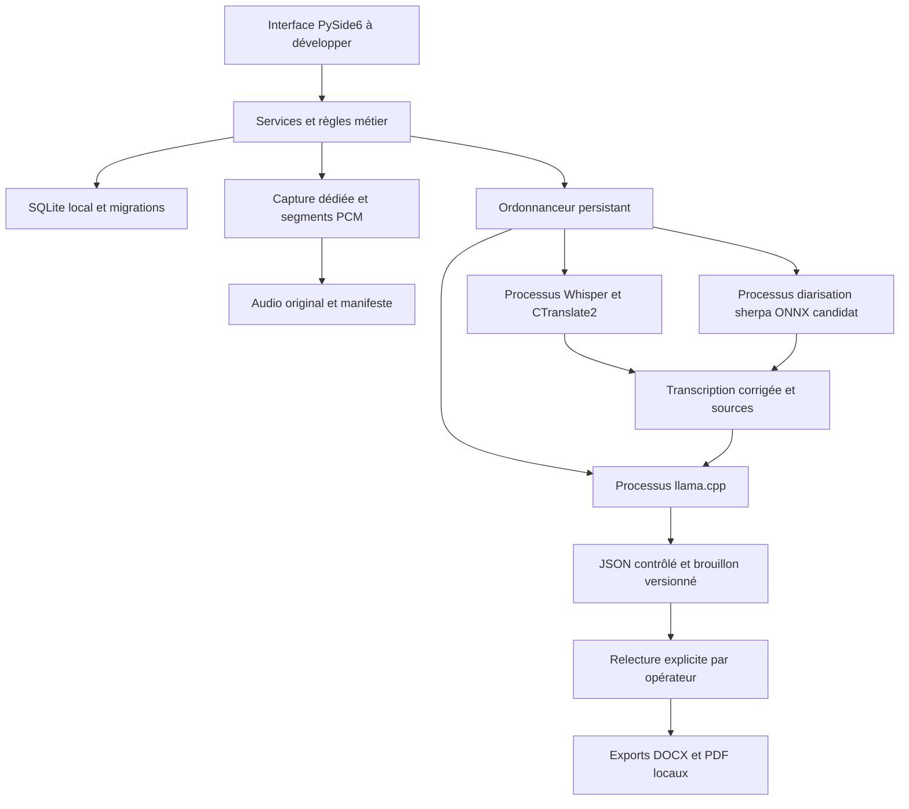

# Historique de l’architecture initiale de phase 0

## Décisions initiales

Le produit cible Windows x64. Python 3.11 est le langage de départ et PySide6
Widgets le choix d'interface à qualifier. Le nom NoteTaker remplace ConseilNote
dans le produit, les chemins de données et l'installateur. Les pages d'interface
ne sont pas encore développées. Les fichiers de `src/notetaker` sont des
fondations et sondes techniques ; les protocoles déclarent des contrats futurs.

## Séparation des responsabilités

| Répertoire | Rôle | État |
|---|---|---|
| `domain` | Contraintes du brouillon, références et trace de relecture liée au contenu | Socle implémenté |
| `services` | Contrats des services, export technique, expérience de durabilité PCM | Partiel |
| `infrastructure` | SQLite, écritures atomiques, vérification SHA-256, politique hors ligne, lancement workers | Socle testé |
| `engines` | Routage avec essai GPU puis repli CPU | Testé pour ASR sur cette machine |
| `workers` | Sondes ASR, sherpa et adaptateur Community-1 local | ASR et sherpa CPU exécutés ; Community-1 non validé |
| `schemas` | Schéma JSON du premier brouillon minimal | Testé et employé avec llama.cpp |
| `scripts` | Acquisition de build, sondes, fixtures et QA | Développement uniquement |
| `models`, `runtimes` | Poids et exécutables locaux immuables | Exclus de Git, manifeste versionné |
| `ui` | Tableau de bord, enregistrement, correction, PV, paramètres | Phase 1, non créé |

La candidate sherpa a été ajoutée à la demande de l'utilisateur après le refus
d'acquisition de Community-1. Ses deux modèles sont chargés depuis leurs fichiers
ONNX ; elle ne nécessite pas la pile PyTorch. L'ancien adaptateur pyannote reste
un objet d'étude, et n'est pas choisi pour le lot de distribution. Les limites
de la candidate sont consignées dans `diarization-alternative.md`.

La UI ne charge aucun moteur. Chaque tentative CPU/GPU utilise un nouveau
processus, avec délai maximal et résultat contrôlé. ASR, diarisation et LLM
ont des environnements et répertoires DLL distincts. Une initialisation GPU
réussie ne suffit pas : la sonde doit transcrire, diariser ou générer réellement.
La sonde native ASR a effectivement planté sans arrêter le parent.

Le protocole de production utilisera JSON avec version, `job_id`, `session_id`,
type, étape, progression, code d'erreur et chemins de résultats. La sonde actuelle
emploie un fichier JSON de requête et stdout JSON final, sans progression ni
annulation coopérative. Le worker LLM est pour l'instant lancé par le script
de sonde, pas encore intégré au gestionnaire de jobs. Une tâche IA à la fois
limite la RAM ; la capture doit rester indépendante et prioritaire.

## Persistance et récupération

SQLite utilisera WAL, clés étrangères, `synchronous=FULL` et migrations
transactionnelles. La première migration contient seulement `session` et `job`.
Le schéma complet du cahier des charges reste à développer : commune, élus,
présences, pouvoirs, ordre du jour, audio, locuteurs, énoncés, votes, révisions,
exports. Les identifiants de séance sont toujours séparés. Une migration échouée
annule ses instructions et son numéro de version. Une base plus récente est refusée.

Au redémarrage, les jobs `running` deviennent `interrupted`. Leur reprise sera
explicite et idempotente après vérification des entrées et des fichiers existants.
Les jobs `completed` et exports ne sont jamais rejoués automatiquement.
Le prototype de sauvegarde SQLite utilise l'API backup et inclut le WAL validé ;
il ne sauvegarde pas encore l'audio. Une archive complète devra prendre un
instantané cohérent DB + manifeste + audio, vérifier les hashes avant restauration
et refuser d'écraser une séance existante sans décision explicite.

L'expérience PCM écrit un fichier `.partial`, ferme le WAV, flush/fsync, renomme,
puis remplace atomiquement le manifeste. Les fichiers orphelins entre renommage
et mise à jour du manifeste sont signalés ; les fichiers incomplets restent
présents. Un seul écrivain est supposé. Ce code ne capture pas le microphone,
ne répare pas le segment en cours et ne prouve pas la résistance à une panne
électrique. La capture de production devra journaliser périodiquement les trames
écrites et limiter la perte du segment actif.

## Données et installation

Programme et modèles sous Program Files, données modifiables sous
`%LOCALAPPDATA%\NoteTaker`, archives dans un emplacement choisi par la collectivité.
Les modèles ne partagent jamais le répertoire des séances. Aucune donnée utilisateur
ne doit être écrite dans Program Files. L'application n'exige ni service Windows,
ni port réseau, ni compte cloud. Les scripts de téléchargement ne seront pas
collectés par PyInstaller.

Le futur build comprendra plusieurs bundles workers isolés et un bundle UI
PyInstaller onedir. Inno Setup devra inclure ces dossiers, poids, DLL autorisées,
polices et notices dans un seul `NoteTaker-Setup.exe`. Le choix ne sera validé
qu'après mesure du volume compressé, voir `feasibility.md`. Des Job Objects Windows
seront nécessaires pour fermer tout arbre worker lors d'un timeout et imposer
les limites mémoire ; le prototype n'offre pas encore cette garantie.

## Contrôle du contenu

Le LLM reçoit uniquement des sources corrigées, ordre du jour et données saisies.
Les sorties devront citer les segments, conserver les inconnues et réutiliser
les votes structurés sans calculer de vote absent. Le schéma initial rejette
les champs non prévus et les identifiants de vote inconnus. Il ne vérifie pas
la véracité du texte libre. Les vérifications de noms, montants et dates et
le traitement hiérarchique de longues séances restent à implémenter.

La relecture est liée à une empreinte du contenu ; toute modification invalide
l'autorisation d'export. L'API n'est pas un contrôle d'identité : la UI devra
recueillir l'action explicite de l'opérateur et persister son historique. Les
fixtures de test ne prouvent pas l'existence de cette UI. Aucun export ne peut
porter automatiquement une signature ou une mention d'adoption.
